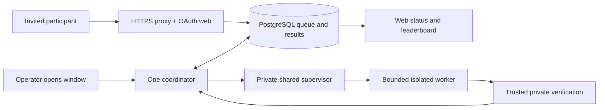

# Smaller 0.5.0 research preview — accepted policy

Review date: 2026-10-26. **Policy accepted; S02 implementation contract reviewed.** No deletion, installation, evaluation,
epoch, notification or launch is authorized. The matrix below records procedural replacements; retained runtime gates still apply. Scope: existing VPS, $0, tiny synthetic instances, frozen
0.5.0 scoring and verification; 0.6.0, C diagnostics, capacity investigations and
backup setup remain outside scope.

## Owner policy acceptance — 2026-10-26

The owner accepted all recommendations in the S01 decision discussion: supervised
invited preview with explicit evaluation windows and paused restart behavior;
a fixed reviewed installation/restoration procedure instead of completing the
general installer; reviewed v4 unmeasured-capacity policy with unchanged limits,
reserve, exclusion and native acceptance; manual availability checks at window
open/close, every 15 minutes while open and daily while closed, with the owner
responsible for checks and incident response; and continued backup deferral with
explicit acceptance of potential permanent database/result/private-evidence loss.
If frozen workloads cannot complete safely, evaluation remains closed.

Local engineering, tests, fresh-agent reviews and local commits are authorized.
This accepts the policy direction and authorizes preparation of its implementation;
it does not assert that the gate mapping or independent S02 review has passed.
The finite S01 gate mapping is complete below; independent S02 contract review is complete below; S03 remains unimplemented. Existing runtime validators and historical receipt meanings remain intact;
no operational receipt may be fabricated or a capacity guard silently bypassed.
Installation, native execution, production evaluations, deletion, invitations and
publication retain their applicable separate approvals. No push is authorized.

The unattended orchestration runner, structured progress/handoffs and restart/
review-failure rehearsal are still to be implemented and verified. Until then,
the numbered workflow can be conducted through individual fresh sessions but
cannot automatically chain itself. Host-fact and live-action blockers in later
sessions remain explicit stop points, not reasons to delay authorized local work.

## Recommended operating design (one-page procedure)

Choose an invited, supervised preview. Keep the website and database available;
accept bounded submissions into the existing PostgreSQL queue. Run the coordinator
only during an announced window with a named operator present. Participants use
GitHub login, create a token, submit an immutable eligible Python source commit
with an idempotency key, inspect status and see verified cohort results. Waiting
outside windows is expected and must be stated on the submission page.

The operator prepares one audited private epoch/reference/cohort under separate
authority before participant work. Keep one immutable application/runtime release,
its private configurations and one verified compatible rollback. Deploy from an
exact reviewed command sheet: pause admissions and computation, require zero
pending work, stop identified scheduling owners, install pinned artifacts, inspect
actual identities, test the installed controls, then verify TLS/login and one
separately authorized functional journey. Preserve web/database/proxy where possible;
never run an implicit migration during an application switch.

At each window, check HTTPS, database readiness, queue bounds, retained services,
resource floors, supervisor identity and absence of unresolved ownership. Explicitly
resume the supervisor and start the sole coordinator. The supervisor retains
host-wide exclusion with administrative work, containment, bounded disk/output,
termination verification and commit reconciliation. An operator cannot substitute
for these protections. At window close, stop new dispatch through a reviewed pause
procedure, let the current job finish or use verified cancellation, inspect that
owned resources are gone, and leave computation persistently paused across reboot.
Queued jobs stay queued. Admission closure is separate from dispatch pause.

On a crash or restart, remain paused. Inspect the durable ownership journal and
matching database attempt; verify termination and reconcile any result commit
before releasing ownership. Never clear a lease, delete a journal or rerun an
ambiguous computation. For a failed deployment, keep computation inhibited, restore
the pinned compatible application/runtime/configuration using the command sheet,
check retained services and identities, then explicitly reopen a window. If schema
compatibility or termination is uncertain, stay offline for evaluation. Rollback is
not recovery from database loss. Assign manual HTTPS checks at window open/close
and every 15 minutes while open, plus daily while closed, with a named incident
contact. This trades unattended detection for documented operator responsibility.

## What exists and what launch requires

The minimum launch is authenticated access, bounded admission/execution, a correct
private audited evaluation, trustworthy transactional publication, basic availability
checks and a usable paused recovery procedure. It does not require continuous
execution, automatic repair or a reusable installation framework.

Evidence is repository-local, not a fresh VPS inspection. [Production Compose](../compose.production.yaml)
already separates proxy/web/database/coordinator, pins images through required
variables, bounds admission (defaults 1 outstanding/account, 2/day, 10 queued),
removes the coordinator Docker socket and requires a private supervisor.
[Submission services](../src/mldsafail/web/services.py) enforce idempotency and
admission; [queue](../src/mldsafail/evaluator/queue.py) serializes claims and refuses
stale recovery without verified termination. [Coordinator](../src/mldsafail/evaluator/coordinator.py)
and the [runtime runbook](SINGLE_WORKLOAD_DEPLOYMENT.md) describe private dispatch,
verification and commit acknowledgement. These are source facts, not installed
acceptance. [Historical host inspection](acceptance/integration/maintenance-feasibility-20261020.md)
found about 2 GiB physical RAM, a restarting coordinator and old checkout sources
without the reviewed mutex. Do not assume that checkout or Compose describes the
running release. The [latest engineering handoff](acceptance/production-preparation/protected-runtime-engineering-20261026.md)
and [control guide](WORKLOAD_CONTROL_ENGINEERING.md) still require privileged host
facts, installed acceptance and complete proposal review. No evidence establishes
that the frozen workload will complete on this VPS under the retained limits.
Failure to fit means keep evaluation closed, not weaken limits or scoring.

## Three concrete choices

| Design | Participant and operator experience | Protections and remaining blockers | Complexity actually removed |
| --- | --- | --- | --- |
| Current automated design | Continuous bounded queue dispatch; operator maintains generic bootstrap, journals, collectors, scenario runners and recovery tooling. | Retains shared containment and commit safety. Requires host facts, complete installation/restoration proposal, installed native acceptance, policy disposition, audited epoch, TLS/auth and final journey. | None; most general machinery must be finished and accepted. |
| Smaller automated design | Same continuous submissions/results; fixed release installed manually; operator handles recovery on incident. | Same runtime boundary; still needs all actual host/control/benchmark gates and unattended availability responsibility. Fixed-install and recovery checks replace generic installer coverage. | Removes generalized installer/continuation paths from the supported launch workflow, but continuous dispatch still needs unattended operating coverage. |
| **Supervised preview (recommended)** | Small invited cohort queues work; results arrive during published operator windows. Operator opens/closes windows and reconciles incidents using the procedure above. | Same isolation, score, privacy, transactional results and native enforcement. Adds persistent window gate and explicit operating responsibility; actual epoch and final deployment remain blockers. | Also removes unattended scheduling/reopening and automated availability recovery from launch scope. Does not remove cleanup, journals or commit reconciliation. |

Supervision limits exposure and makes the operating commitment credible for a $0
preview; it does not solve insufficient memory or sandbox escape. Smaller automatic
dispatch can follow after real operating experience. If nobody accepts the manual
cadence, this recommendation is not ready to launch.

## Prioritized dispositions and affected areas

Each row states the need, burden, alternative and consequence. “Remove” means a
future reviewed change to the supported launch path, not permission to delete now.

| Priority / component | Need and cost | Proposed disposition, resulting behavior and risk | Specific areas |
| --- | --- | --- | --- |
| P0 authentication, HTTPS, sessions, CSRF, tokens | Prevent unauthorized account actions; OAuth/TLS secrets and renewal require real checks. | **Keep.** Existing GitHub auth and proxy; no alternate login system. Failure closes admission. Verify real callback and renewal/reload. | `src/mldsafail/web/auth.py`, `api.py`, `compose.production.yaml`, `deploy/Caddyfile.production`, `reload_production_tls.py` |
| P0 queue, quotas, idempotency, cancellation | Prevent duplicate evaluation and backlog growth; DB concurrency is real complexity. | **Keep.** One queue, existing bounds; supervision adds no queue. Different keys still consume quota. Cancellation must verify cleanup before new work. | `web/services.py`, `web/models.py`, `evaluator/queue.py`, `repositories.py` |
| P0 private evaluator, source validation, audit, verification and cohort publication | Protect secrets and scientific correctness; frozen dependencies are necessary. | **Keep unchanged.** Invalid answers ineligible; frozen timeout/no-answer penalties remain. No email/file-based scoring substitute. | `benchmark_v050/`, `evaluator/source.py`, `evaluator/coordinator.py`, `web/comparison.py`, `docs/PRIMITIVE_SELECTION_SPEC.md` |
| P0 host lock, supervisor, native adapter and watchdog/independent cleanup | DB lease alone cannot stop surviving containers; memory/output exhaustion threatens retained services. Cost: cgroups, private socket, identity journals and bounded storage. | **Keep.** Watchdog detects failure, cleanup stops creators/workers; neither may automatically reopen scheduling. Manual observation cannot replace kernel enforcement or termination proof. | `evaluator/workload_service.py`, `evaluator/native_workload.py`, `deploy/workload_watchdog.py`, `workload_native_supervision.py`, `SINGLE_WORKLOAD_DEPLOYMENT.md` |
| P0 resource and scheduling prerequisites | Existing owner direction requires one heavy workload, CPU/RAM/PID/disk/output limits and host reserve. Full scheduler inventory is burdensome but unknown restart owners can overlap. | **Keep, scope to the fixed installation.** Classify all actual trigger owners once, inhibit competing heavy work, refresh relevant identities for execution. No blanket exemption for cron, other accounts or existing backup timers. No capacity experiment. | `deploy/workload_schedule_v3.py`, `privileged_scheduling.py`, `workload_owner_readers.py`, `PROTECTED_RUNTIME_OWNER_COLLECTION.md` |
| P0 workload journal, DB/operator commit barrier and reconciliation | Interrupted insertion can lose or duplicate results; costs identity binding and explicit recovery. | **Keep.** Publication remains transactional, acknowledged work is not recomputed. Ambiguity blocks launch. This is distinct from generalized installation recovery. | `evaluator/` protected dispatch, `deploy/protected_epoch.py`, `workload_native_protocol.py`, runtime runbook |
| P1 always-on coordinator and retry/reopen policy | Unattended throughput is optional for invitees; restart policies can launch work when nobody is watching. | **Simplify** to persistent closed-by-default window control, explicit resume, bounded FIFO dispatch. Remove unattended reopening; review ordinary infrastructure retries so none escape the window or repeat ambiguous outcomes. Loss: delayed results and operator dependence. Not implemented today. | `compose.production.yaml` coordinator restart policy, `evaluator/coordinator.py`, `deploy/workload_units.py`, `ADMINISTRATIVE_CONTROLS.md` |
| P1 deployment/install recovery framework | Safe installation and rollback are needed; generic external-effect continuation, VM fixtures and protocol matrices multiply dependencies. | **Simplify** to one host-bound command sheet with before/after evidence and manual stop-on-ambiguity. **Defer** generic restartable installer. Interrupted steps require inspection before fresh authority, not blind replay. Retain known-good artifacts and verify rollback; manual steps are explicit work, not eliminated work. | `deploy/workload_installation.py`, `workload_mutation.py`, `workload_recovery_inventory.py`, `workload_v3.py`, `scripts/workload_installation_fixture.py`, `PROTECTED_RUNTIME_IMPLEMENTATION_PLAN.md`, `WORKLOAD_INSTALLATION_FIXTURE.md` |
| P1 overlapping acceptance and approval packets | Exact authority and independent review protect live services; repeated nested prerequisites obscure readiness. | **Simplify** to one release-bound installation/control acceptance matrix, one exact installation proposal and separate epoch/activation authorities. Reuse matching receipts; do not infer passes. Keep distinct authority scopes. Loss: less generic automation coverage, compensated by fixed-install interruption checks. | `deploy/workload_acceptance_packet.py`, `workload_packet_preparation.py`, `scripts/prepare_workload_packet.py`, `PUBLIC_LAUNCH_PACKET.md`, `LAUNCH_PREPARATION.md` |
| P1 protocol generations and validators | Historical receipts must remain interpretable; supporting every generation for new launches invites confusion. | **Remove** v1–v3 selection from the new launch path; select current v4 administrative authority only. Preserve old validators/records read-only until dependency audit proves archival separation. Loss: no new launch from old packets. No historical validation rules weakened. | `deploy/production_maintenance.py`, `production_epoch_operation.py` in `scripts/`, `deploy/workload_native_packet.py`, `workload_v3.py`, `SINGLE_WORKLOAD_DEPLOYMENT.md` |
| P1 availability, alerts and automatic recovery | Need to notice outages; lease alarms and auto recovery add failure paths. | **Simplify** to named manual checks/cadence above; **defer** remote lease alerts and automatic repair/activation. Keep local watchdog/cleanup. Loss: outages between checks and outside windows can last longer; HTTPS does not certify worker health. No notification sent by this review. | `deploy/healthchecks.py`, `host_checks.py`, `recovery_daemon.py`, `daily_recovery.py`, `operator_activation.py`, `scripts/monitoring_fault_acceptance.py`, MVP item 7 |
| P2 diagnostic/capacity/0.6.0 and backup workstreams | Historical tools explain outcomes but are not launch functionality. Additional campaigns create cost and scope creep. | **Defer**, remove as launch prerequisites only where already owner-settled. Preserve failures and scientific evidence. Backup absence means irreversible data-loss risk; existing timers cannot be disabled under this proposal without their own disposition. | `scripts/production_diagnostic*`, `capacity_investigation*`, `benchmark_v060/`, `deploy/backup_postgres.py`, `install_restic.py`, dated acceptance packets |
| P2 release caches, duplicate contexts and trial stores | Needed only while active or for unresolved evidence; disk burden matters on VPS. | **Remove eligible bulk later** under retention ownership/inactivity checks; keep compact records, current installation, verified rollback and scientific evidence. Risk: mistaken classification destroys recovery; no broad prune or shared-hardlink edits. | `RETENTION_POLICY.md`, `BUILD_CACHE_RETIREMENT.md`, `scripts/retire_build_cache.py`, `retain_release.py` |

## S01 finite launch acceptance matrix — 2026-10-26

This inventory maps current requirements to acceptance work; it is not a passing
launch receipt. Sources: [PLAN](PLAN.md) source requirements and sections 2–10,
[MVP decisions and eight items](MVP_LAUNCH_PREPARATION.md),
[runtime runbook](SINGLE_WORKLOAD_DEPLOYMENT.md),
[older launch preparation](LAUNCH_PREPARATION.md) and
[older public packet](PUBLIC_LAUNCH_PACKET.md). Keep retains the obligation;
replace requires the specified narrower evidence; historical preserves old
outcomes without requiring another campaign. Session ownership grants no live
authority. Existing receipts apply only to their exact identities.

| Requirement / source | Disposition | Acceptance evidence and existing state | Responsible session / remaining authority |
| --- | --- | --- | --- |
| Safety, tiny profiles, private data, scoring and verification — PLAN 2–5, frozen spec, AGENTS.md | Keep | Frozen 0.5.0 worker/locks, public-only contestant inputs, trusted verification, invalid answers ineligible and frozen 60-second failure penalty. Bind exact source/image/fingerprint/cohort. No practical targets, private tuning or changed score semantics. | S02 trace; S08/S14–S18 verify; separate evaluation authority. |
| 0.6.0 adoption/native accounting campaign — old public packet decisions, MVP scope | Replace / historical | 0.5.0 preview with explicit cooperative-timing limitations in final package/packet. No hostile-code timing claim or relabeled historical scores; no 0.6.0 campaign required. | S08/S18; owner publication scope later. |
| Retained artifacts, worker provenance and participant package — MVP 1–2, old distribution section | Keep | Reuse matching archive/clean-install receipts; original worker build commit unknown with accepted preview limitation. Freeze current candidate and compatible rollback dependency closure; independent exact public archive/privacy review. Packaging passed locally, nothing published. | S08/S17/S18; publication remains owner action. |
| Production config/secrets/images/schema/namespace isolation — MVP 3, public packet configuration discipline | Keep | Preparation passed for recorded bytes, full validation awaits audited epoch. Fresh scoped secrets, disjoint staging paths/volumes, immutable images, explicit initial migration/schema verification. Switches cannot migrate implicitly. | S08–S11/S14–S17; exact installation/epoch authority. |
| HTTPS/OAuth/sessions/CSRF/token lifecycle/private DB and proxy boundaries — MVP 5 | Keep | Real selected-deployment TLS trust and renewal/reload, GitHub callback/login, secure cookies, CSRF and token creation/revocation/expiry receipts. Supplied OAuth choices settled; synthetic authentication insufficient. | S16; applicable listener/deployment authority. |
| Queue/quota/rate limits, immutable source, idempotency/cancellation — PLAN source requirements, MVP 6 | Keep | Concurrent duplicate/same-key-body-conflict and quota checks, one bounded queue, eligible Python/public inputs and immutable source. Cancellation retains ownership until cleanup. Existing queue/services source is not installed proof. | S03–S06/S13/S17; final journey separately authorized. |
| Always-on dispatch/automatic reopen — review operating procedure, runtime recovery | Replace | Persistent closed-by-default windows; atomic close/claim across coordinators. Closed queue waits without consuming attempts; missing/corrupt state and restart inhibit launch. Close prevents next dispatch; active job finishes protected or uses verified cancellation. Admission closure remains separate. Not implemented. | S03–S06 source/tests; S12–S13 installed observations; operator opening requires applicable authority. |
| Shared host exclusion, all scheduling/restart owners and administrative fence — PLAN source requirements, runtime transactions | Keep | Actual all-account/cron/container trigger/reference inventory and inhibition; host-wide lock before participant claim or administrative zero-pending SQL fence. Queued jobs block maintenance; window permission never grants administrative authority. | S03–S04/S06–S07/S09/S13–S15; privileged facts missing; exact live authority required. |
| Host/ancestor CPU/RAM/PIDs/swap/reserve — runtime resource enforcement | Keep | Actual delegation and ancestor births/allowances; admission floors 1 GiB available RAM and 5 GiB free disk; aggregate RAM bounded by physical minus reserve/effective ancestors, one CPU, 448 PIDs, zero swap, frozen worker limits. Resource deferral leaves jobs queued; retained web/DB/proxy checked before/after. Workload fit remains unknown. | S07/S09–S14; separately authorized native checks/epoch. |
| Storage/output enforcement — runtime resource enforcement | Keep | Installed ext4/xfs output maximum 1 GiB with noexec/nosuid/nodev; kernel combined log bound 128 MiB, two 64 MiB participant or up to eight 16 MiB admin streams. Size scans insufficient; actual storage facts missing. | S07/S09–S13; exact installation/native authority. |
| Isolation, peer rejection, watchdog/independent cleanup — runtime native gate, control registry | Keep | All required controls and all 27 registered scenarios need matching installed injection/observer/order/identity, independent cleanup/postflight and retained-service evidence. Source runners/local Linux/PostgreSQL checks exist; all full installed-native scenarios unexecuted. Three-case helper cannot pass complete controls. | S06/S10 local; S11–S13 independent review and exact native authority. |
| Positive termination, stale leases, parent/worker death and protection failure — runtime resources/recovery | Keep | Absent owned containers and empty owned cgroups with birth binding before release; no lease-expiry replacement. Parent OOM/monitor loss/aggregate exhaustion means infrastructure failure, no score/automatic retry, persistent pause. Uncertain cleanup retains blocked ownership. | S04/S06/S13; native cases separately authorized. |
| Retry eligibility, DB/operator commit barrier and reconciliation — runtime transactions, protected epoch | Keep | Ordinary infrastructure retry only after verified cleanup/reconciliation and still-open window. Durable commit intent plus DB/operator reconciliation preserves committed result once; uncommitted orphan becomes infrastructure failure after cleanup. No recompute on lost acknowledgement, journal deletion, attempt reset or legacy-expired-job requeue. | S02 finalize; S04/S06/S13/S15/S17 verify under applicable authority. |
| Measured capacity — maintenance/policy validators, MVP 4 | Replace for new v4; historical v2/v3 unchanged | Explicit unmeasured_capacity with exact resource-policy hash, complete control-specific evidence, independent reviewer/executor and exact owner/reviewer packet bindings. Preparation freshness 24 hours, live five minutes. Existing v4 implementation lacks installed acceptance. No fabricated receipt, unconditional bypass or certified-sizing claim; inability to fit keeps evaluation closed. | S02 trace; S08–S14 bind/review; S15 separate epoch authority. |
| Generic bootstrap/installer/general continuation and VM acceptance — runtime configuration/recovery, implementation/fixture plans | Replace | One exact host-bound release/install/restore sheet: original settings, dependency closure, before/after observations, each mutation's interruption inspection/reversal, local image-load/service-switch/inhibition/restore rehearsal, independent exact-byte review, paused installed receipt. Generic completeness deferred, not passed. Failed 35-second VM image-load rehearsal stays failed. | S07–S11 local/review; S12 exact installation authority; S13 separate native authority. |
| Overlapping packets/protocol generations — runtime runbook, epoch CLI | Replace new launch routing only | One matrix/release-bound installation proposal; distinct installation/native/epoch/rollout grants. New administration selects v4 end to end; historical readers/guards unchanged. Actual installed supervisor/socket/cgroup/mount/image births required; proposed identities cannot pass. | S02/S08–S11/S14; align entrypoints/defaults/runbooks and test before execution. |
| Fresh epoch/reference/audit/seal/cohort — MVP 4, production epoch procedure | Keep | One separately authorized fresh 0.5.0 attempt on selected host/frozen worker; independent audit/seal/reference and final cohort/full config receipts. No staging/C reuse, automatic second attempt or private tuning. Preserve partial/failed evidence. Preparation is not execution. | S14 exact packet/review; S15 explicit epoch authority. |
| C/load/pacing/monitor investigation, old seven staging scenarios/full production rehearsal — PLAN 10, old public rehearsal | Historical / replace release acceptance | Preserve failed loaded reads, lease inspection, uncertain pacing and unreached cases. No new campaign. Required failure behaviors covered by S06/S13 plus one final release-bound functional journey; scoped old fault passes cannot certify new runtime. | S02 check coverage; S06/S13/S17/S18; no new load rehearsal authorized. |
| Application rollback/forward and interrupted deployment — MVP 7, old rehearsal | Keep recovery; replace generic workflow | Compatible complete dependency closure and schema disposition, exact stop/inspect/restore sheet, local interruption/restore receipts and matching installed-control evidence. Recheck usable recovery at final journey. No implicit migration/downgrade/DB restore; uncertainty stays paused. | S08–S13/S17; any live restore check separately authorized. |
| Encrypted off-host restore/backup freshness/custody/timers — old preparation operations, PLAN 10 | Replace / defer setup | Accepted potential permanent DB/result/private-evidence loss recorded in go/no-go. Application rollback cannot recover data loss; no backup pass claimed or new storage prerequisite. Existing timer owners still inventoried; no implicit disabling. | S07/S09/S18; policy settled; exact live changes need authority. |
| Remote lease alerts/heartbeats/automatic repair — old operations, MVP 7 | Replace / defer automation | Owner manual HTTPS checks open/close, every 15 minutes open and daily closed; record incident contact and window preflight for DB/queue/resources/supervisor/unresolved ownership. Walk through paused incident response; HTTP cannot prove worker health. Keep local watchdog/cleanup. Old lease failure stays failed, no notifications sent. | S05/S16/S18; owner responsibility accepted, contact/window fields finalized before rollout. |
| Three-person external pilot — old pilot, MVP 6/8 | Replace launch prerequisite with final journey; recruitment separate | One final-package clean install → public validation → immutable submission/status → verified audited cohort result, idempotency and applicable cancellation, release-bound receipt. Old pilot not reported passed; invitations/consent/observations remain unexecuted. | S17/S18; specific journey authority; separate recruitment authority. |
| Go/no-go, activation/publication — MVP 8, old publication sequence | Keep decision boundary; replace obsolete checklist | Final matrix reconciles actual scoped passes/failures and release/config/worker/cohort IDs, cooperative timing/manual operations/data-loss limitations, exact rollout commands and blockers. Old canonical ledger remains historical, cannot pass by omission. | S18 review; S19 explicit activation scope; owner pushes/publishes, invitations separately authorized. |
| Retention/cache/dead-code retirement — retention policy | Keep; optional post-acceptance | Compact permanent records, unresolved-failure evidence, scientific data, current install and verified rollback retained. Ownership/inactivity/path checks before eligible bulk removal; no shared-hardlink mutation or broad prune. No S01–S02 deletion. | Optional S20–S21 scoped removal; not a new launch blocker. |

### Protocol identities and fixed-install substitution

Administrative `mldsafail.production-operation.v4` routes through
[protected_epoch.validate](../deploy/protected_epoch.py),
[production_maintenance.packet_state](../deploy/production_maintenance.py) and
[workload_policy.validate_controls/authorize](../deploy/workload_policy.py), selected
by [the epoch CLI](../scripts/production_epoch_operation.py). Historical v2/v3
administrative validators still require measured-capacity receipts. V4 substitutes
reviewed unmeasured controls, without relaxing limits or claiming capacity.

Those numbers do not select installer versions. [workload_v3.py](../deploy/workload_v3.py)
compiles v3 bootstrap proposals/installed acceptance; the runbook also describes
v1/v2 bootstrap preparation. Protocol-four recovery in the
[engineering handoff](acceptance/production-preparation/protected-runtime-engineering-20261026.md)
binds mutation/continuation receipts. Neither an administrative v4 grant nor a
protocol-four recovery receipt proves installation or complete bootstrap approval.

S08–S11 must align fixed-path entrypoints, validators, defaults and documentation.
The fixed sheet replaces general installer completeness/continuation coverage,
not actual host inventory, UID maps, delegation, storage, original settings,
release/rollback closure, interrupted-step inspection or independent exact review.
It requires a local selected-path rehearsal, separately approved paused install
and actual identities, then separately authorized native checks for every retained
control before epoch approval. Failed local fixtures cannot become installed
passes. S01 changes no executable selector, runtime API or benchmark bytes.

## S02 independent verification and implementation contract — 2026-10-26

This fresh session independently reviewed S01 at `2d5f7c8` against current
requirements and executable validators. The matrix above is retained with the
clarifications below. No material conflict with the accepted owner policy was
found. This is a reviewed local implementation contract, not installed acceptance
or approval of a future execution packet. Historical S01 handoff text remains
unchanged as a dated record.

### Requirement and validator trace; matrix clarifications

| Matrix rows / requirement source | Independently checked implementation / resulting obligation |
| --- | --- |
| Safety, science, package, epoch and cohort — PLAN 2–7 and frozen spec | [Frozen specification](PRIMITIVE_SELECTION_SPEC.md), [0.5.0 constants](../src/mldsafail/benchmark_v050/constants.py), [evidence audit](../src/mldsafail/benchmark_v050/evidence.py), [production preparation](../deploy/production_preparation.py) and [protected epoch validation](../deploy/protected_epoch.py). Preserve all 100 ranked cases, one warmup/three measurements, independent correctness, invalid warmup ineligibility, equal five-cell score, anchored ties and uncertainty. Partial evidence cannot rank; raw evidence stays private. Package privacy review includes archives and diagnostics, not just solver inputs. |
| Authentication/configuration/admission/journey — MVP 1–6, old public packet configuration and rehearsal | [Production preflight](../deploy/production_preflight.py), [web services](../src/mldsafail/web/services.py), [API](../src/mldsafail/web/api.py), [authentication](../src/mldsafail/web/auth.py), [comparison](../src/mldsafail/web/comparison.py) and production Compose. Retain authentication failures, trusted proxy/security headers and rejection of operational paths, as well as TLS/cookie/CSRF/token lifecycle. S16 records those actual-deployment observations; S17 binds result/API/leaderboard privacy and version/epoch identities, including reconciliation of a lost submission response by its original idempotency key. |
| Windows, exclusion, cancellation, retries and commits — PLAN source requirements, runtime transactions | [Queue](../src/mldsafail/evaluator/queue.py), [coordinator](../src/mldsafail/evaluator/coordinator.py), [dispatcher](../src/mldsafail/evaluator/dispatcher.py), [supervisor gate](../src/mldsafail/evaluator/workload.py), [private protocol](../src/mldsafail/evaluator/workload_socket.py) and [maintenance fence](../deploy/maintenance_fence.py). Existing protected dispatcher obtains host ownership before SQL claim; no persistent participant window exists. Existing ordinary failure retry and generic stale-job requeue are source paths to review in S04, not proof of the new contract. |
| Resources, storage, isolation, termination and native scenarios — runtime runbook | [Native adapter](../src/mldsafail/evaluator/native_workload.py), [control shapes](../deploy/workload_controls.py), [registry](../deploy/workload_control_registry.py) and [native context](../deploy/workload_native_context.py). Preserve all 27 scenarios across 17 controls, plus peer-UID rejection and bounded socket behavior. S11 enumerates exact native cases/authority; S13 records installed observations. The registry distinguishes host-required origins from disposable/local evidence for other controls; local fixtures never become installed-native receipts. The launch contract retains the complete installed bridge and independent cleanup/postflight, not merely the three-case helper. |
| Unmeasured capacity, scheduling census and administrative generation — PLAN source requirements, runtime policy | [Maintenance packet state](../deploy/production_maintenance.py), [workload policy](../deploy/workload_policy.py), [protected epoch](../deploy/protected_epoch.py) and [epoch CLI](../scripts/production_epoch_operation.py). V4 execution still requires verified scheduling exclusion and hash-bound privileged scheduling v2 evidence. A maintenance-proposal state is preparation only. Preserve v2/v3 measured-capacity guards. New release routing must reject legacy execution selection without breaking historical validation. |
| Fixed install, rollback, old rehearsal/pilot/load, manual checks, deferred backups and retention — MVP 7–8, older packets, PLAN 8–10 | [Runtime runbook](SINGLE_WORKLOAD_DEPLOYMENT.md), [engineering handoff](acceptance/production-preparation/protected-runtime-engineering-20261026.md), [MVP decisions](MVP_LAUNCH_PREPARATION.md), [older preparation](LAUNCH_PREPARATION.md), [older packet](PUBLIC_LAUNCH_PACKET.md) and [retention policy](RETENTION_POLICY.md). Replacement evidence remains S09–S13 fixed-path interruptions/restoration, S16 manual procedure, S17 final journey and S18 explicit risk/go-no-go. No new full load campaign, pilot, off-host backup setup or generic installer completeness is required. Existing failures and unfunded recovery remain recorded; no cleanup is performed by S02. |

V4 evidence details omitted from the short matrix are mandatory, not optional:
`validate_controls` binds the receipt to host, source, operation, resource-policy
hash, all three private configuration files and runtime identities. Configuration
files must be distinct absolute non-symlink, owner-only regular files with one
link and bounded size. Each control artifact and every unique scenario must have
matching hashes, identities, ordered injection/observation traces and the exact
control-specific observations (including kernel output enforcement and bounded
monitor latency). Reviewer and executor must differ. Native lifecycle evidence
has the validator's explicit boot/daemon exception; other scenario boot/daemon
bindings must match current runtime. Enduring native evidence applies only to its
exact installed bytes; it is not a substitute for a current live observation.
The enclosing receipt is less than 24 hours old for preparation and live
observation less than five minutes old for execution. Exact owner authorization
is less than five minutes old, binds serialized packet, canonical native config,
roles and independent approved review bytes, and has a positive lifetime at most
9,000 seconds. S11/S14 must validate these existing constraints without rewriting
historical receipts or repeatedly rerunning native tests merely for freshness.

### S03–S06 required behavior and acceptance

The interface names/storage choice are for S03 to select and hand off. The
following observable behavior is fixed; no implementation is claimed here.

| Contract | Required behavior and evidence / session |
| --- | --- |
| Durable authority and open | A single host-wide participant window is closed on first use, missing/corrupt state, reboot, supervisor or coordinator restart. An old persisted open bit cannot authorize a new process generation. Only an authenticated operator action with fresh preflight may open it; web/submission clients cannot open or resume it. Opening must fail with unresolved ownership/commit state or protection pause. Repeated open/close is safe and does not create work. S03 specifies the private API, durable state/version, generation binding and failure responses; S04 covers startup integration. |
| Atomic close and claim | Serialize close with participant authorization and SQL claim across coordinators/databases, retaining host gate before SQL mutex ordering. Close must not return while a previously admitted but unclaimed reservation can later consume an attempt: either drain that critical section before reporting closed or revoke it before SQL claim. A completed pre-close claim is the sole active job; it may finish under existing protection, including launch after close if not yet launched. No later claim/attempt or second dispatch is allowed. Test both race orders, acquire-before-claim interruption, competing coordinators and direct protected launch routes. No status-only precheck, window file read or container stop establishes this guarantee. S03. |
| Graceful close versus protection pause | Ordinary close inhibits new participant claims, preserves queued jobs and permits the one claimed job to finish, verify, clean up and reconcile/commit once. It does not call an aborting protection pause as a substitute for graceful closure. Explicit cancellation retains existing positive termination and commit barriers. Operator status distinguishes closed/active/draining from closed/idle and protection-blocked; report idle only after verified cleanup and acknowledgement. Reopening cannot erase ownership. S03/S05. |
| Administrative roles and admission | Participant open grants no administrative authority; closed windows do not waive exact v4 create/reference/audit grants, host exclusion or zero-pending SQL fence. Separately authorized administration can run while the participant window is closed only after those checks, never concurrently with participant work. Queue entries still block maintenance; closing dispatch does not drain or cancel the queue. Admission remains independently bounded/open or closed, and an admission fence cannot be bypassed by opening a window. S03/S04 test participant/admin contention and queued/claimed/running fence denial. |
| Restart and recovery | All coordinator entrypoints (including one-shot mode and configured production fallback paths), Compose restart policy and units must fail closed. Coordinator construction must not silently reopen or resume. Reconciliation/cleanup of existing ownership remains possible while closed, but cannot launch another computation. Crash at acquire, SQL claim, bind, create/start, result, cleanup, commit intent or acknowledgement leaves computation inhibited until exact state is reconciled and operator explicitly opens. S04 tests restarts of each component and preserves retained services; no journal deletion, lease clearing or attempt reset. |
| Ordinary retry | Only a positively cleaned, reconciled ordinary infrastructure failure with remaining existing attempt budget is eligible. The window must still be open when retry eligibility is committed and again atomically at its next claim. Close/restart during failure handling cannot create a retry that escapes the gate. If closed when failure is recorded, record terminal infrastructure failure without automatic requeue; already queued retries stay queued and consume no further attempt until explicit open. Protection abort, lease/identity/monitor loss, cancellation, ambiguous outcome or legacy expired ownership never automatically retries. Review `apply_outcome(retry=True)`, generic stale recovery and unprotected coordinator branches in S04; reject unsupported production bypasses. No timeout penalty or invalid answer becomes an infrastructure retry. |
| Commit and cancellation races | Preserve durable workload/job/attempt/source/cohort binding. Matching committed result survives lost acknowledgement exactly once; absent commit becomes terminal infrastructure failure (or reconciled cancellation) after cleanup, without reusing orphan output. Conflicting/missing acknowledged records block release/open. Cancellation winning the result transaction cannot publish success; terminal success cannot be recomputed by cancellation/retry. S04 verifies database outage, commit-before-ack loss, uncommitted orphan and cancel/commit races while closed and open. |
| Participant/operator experience | S05 exposes sanitized actual waiting/window/active state, keeping it distinct from admission, quotas and health. No private paths, seeds, configuration or diagnostics cross status/logs. Document preflight, exact open/close/cancel/reconcile instructions, manual cadence (open/close, every 15 minutes open, daily closed), named owner/contact and incident closure. No notifications or real windows opened. |
| Independent acceptance | S06 independently reviews exact S03–S05 commits and runs disposable integrations covering normal/duplicate/conflicting submissions, quota/idempotency, frozen timeout/invalid answer behavior, graceful close, cancellation, admin contention, concurrent claims, missing/corrupt state, restart/crash and interrupted result recording. Record actual test/fixture origins, skipped/failed cases and remaining native gates. Each code session runs focused checks plus `make check`; source-level acceptance never certifies the VPS. |

Unattended chaining has an additional preparation prerequisite after S02 and
before S03: an external fresh-session runner with durable structured handoffs,
verified restart and review-failure rehearsal. This session neither builds nor
certifies that runner. Individually owner-started fresh sessions remain supported;
absence of the runner does not block that mode or authorize automatic chaining.

## Changes that must travel together

Window control, coordinator restart policy, retries, queue status text and operator
pause/reboot tests form one change: stopping a container alone is not persistent
inhibition. Fixed installation must replace the generic installer entrypoint,
its required acceptance matrix, launch documentation and restoration commands
together; simply skipping its failing gate is not simplification. Protocol routing,
packet validators and CLI/documented defaults must select the same generation.
Do not remove legacy modules until imports, historical receipt readers and recovery
consumers have been inventoried. Alert deferral must name the human cadence/contact
at the same time. Retention removal must retain the rollback dependency closure.

## Bounded implementation batches (local preparation authorized)

| Order | Deliverable and acceptance | Reversal |
| --- | --- | --- |
| 1. Freeze the contract | Owner selects supervised windows, manual monitoring and fixed-install policy; independent review maps each old gate to retained, replaced or historical. Explicitly resolve the measured-capacity gate through reviewed v4 unmeasured-capacity policy without measurements or fabricated receipts. Approve no runtime safety waiver. Exit: one finite acceptance matrix, no unresolved safety disposition. | Keep current policy and remain paused; this document alone replaces no gate. |
| 2. Add window behavior | Implement persistent closed-by-default dispatch, explicit resume, participant waiting text and reviewed retry behavior. Check duplicate submission, cancellation, competing coordinator/admin launch, window close and reboot; no work starts while closed. | Revert application/config commit while paused; do not resume an earlier automatic policy without authority. |
| 3. Prepare one fixed install and restore | Inventory actual host triggers/UIDs/cgroups/storage, pinned dependencies and compatible rollback. Write exact install/stop/inspect/restore commands and release-bound checks; locally rehearse interruptions before/after mutation, including image load and service switch. Review independently. No growing generic continuation framework. Exit: complete reversible packet, kernel/output bounds demonstrable, original settings captured. | Retain existing installation untouched until separate execution approval; restore named artifacts/settings on a failed authorized switch. |
| 4. Accept actual runtime | Under separate installation/native-test authority, apply packet paused and verify isolation, limits, peer rejection, parent/worker death, cleanup, startup inhibition and retained-service availability. Ambiguous commit/restart cases must block then reconcile. If frozen workload cannot fit, stop with no score/rule adjustment. | Execute verified restore sheet; leave compute paused if identity/termination is uncertain. |
| 5. Establish benchmark and functional launch | Separately authorize one fresh epoch, audit/seal/reference/cohort; finalize configuration. Verify actual TLS/OAuth/token lifecycle and final participant journey, monitoring procedure and rollback compatibility. Owner reviews exact rollout packet before invitation/publication. | Keep admission/compute closed; retain failed evidence and original epoch outcomes. No automatic epoch retry. |
| 6. Retire unused launch paths | After accepted replacement, remove obsolete launch entrypoints/docs and only dependency-audited dead code in separate commits; preserve historical readers and records. Link/import checks and affected tests must pass. Retention cleanup is separately scoped. | Revert removal commit; restore only matching inactive artifacts, never revive old scheduling owners automatically. |

## Sequential agent implementation sessions

This is the execution map for fresh-context sessions. Local preparation is authorized;
live execution retains separate authority. Use one session per row,
in order, without parallel implementation. The six batches above describe the
architecture; the sessions below divide them into smaller handoffs. Historical
backlogs are evidence, not additional assignments. Do not start the next row in
the same session merely because context or time remains.

### How every fresh session selects its task

When the owner says “Let's review docs/PLAN.md and
docs/LAUNCH_ARCHITECTURE_REVIEW and determine the next course of action for our
public launch,” read `AGENTS.md`, the routing note at the top of `PLAN.md`, this
section, and the latest session handoff. Check the working tree and recent commits
before editing. Select the earliest session whose exit checks are not complete;
read only its listed inputs and the source/tests needed for that task. Do not
restart the whole architecture review or pursue dated agendas elsewhere in PLAN.
Announce the session ID, expected deliverable and applicable authority in chat,
then complete its authorized work. The generic follow-up prompt selects work;
it does not approve a proposed policy or authorize VPS mutations, evaluations,
notifications, invitations or publication.

If a prerequisite or required authority is missing, finish the local preparation
that makes the decision concrete, record the exact blocker and ask for that
specific decision in chat. Keep the same session current. Do not skip it, reopen
cancelled investigations, generate new prerequisite projects or describe an
unexecuted action as complete. Reuse an existing approval when its exact scope
and artifact identities still apply. A material policy disagreement goes to the
owner with a concrete alternative and its consequences.

### Session schedule

Each row inherits the frozen benchmark/safety boundaries and the no-push rule.
“Local checks” means focused tests for code changes plus `make check`; documentation
only sessions use changed-document link checks and `git diff --check`. Disposable
fixtures do not authorize production evaluations. Native rows require the exact
separate execution authority already required by project policy.

| ID / batch | Read first | Exact assignment and deliverable | Exit checks and boundary |
| --- | --- | --- | --- |
| S01 / 1 — policy decision packet | This review, MVP roadmap decisions, runtime runbook, current epoch policy validators | Map every current launch gate to keep/replace/historical in one finite acceptance matrix. Specify proposed supervised windows, manual monitoring responsibility, fixed-install workflow, v4 unmeasured-capacity disposition and deferred-backup risk in ordinary language. Identify exact policy/source changes needed and present the concrete owner choices in chat. | Documentation only. Record actual owner decisions with date/scope; unresolved choices keep S01 pending. Do not treat this session schedule as adoption or waive a safety gate. |
| S02 / 1 — independent contract review | S01 packet and decisions, frozen spec, relevant validator sources | In a fresh session, review the proposed gate mapping against existing requirements. Resolve omissions; distinguish administrative authority protocol versions from installer/bootstrap versions. Produce the approved implementation contract and finite acceptance matrix, with retained native checks and explicit replacements. | Every old launch gate has a disposition and evidence requirement; owner approval covers policy changes. If independent review under applicable policy requires another reviewer, obtain it rather than self-certify. No deployment or broad cleanup. |
| S03 / 2 — persistent window control | S02 contract, supervisor service, coordinator claim path, workload unit/config sources | Implement the smallest persistent closed-by-default window gate and explicit open/close interface. Specify close-during-active-work behavior and administrative-role behavior. Gate all participant dispatch paths atomically against close and restart; retain host-wide lock and commit ownership. | Focused close/claim race, competing coordinators, missing/corrupt state and restart tests plus local checks. No production commands. Hand off the exact interface to S04. |
| S04 / 2 — restart, retries and cancellation | S03 interface/tests, Compose, queue/coordinator recovery, cancellation and cleanup paths | Integrate window gate with coordinator startup/restart policy and ordinary infrastructure retries. Ensure a restart cannot reopen a window, closed windows retain queued jobs, and cancellation/retry cannot release unverified ownership or repeat ambiguous committed work. | Focused crash/restart, retry-after-close, cancellation and commit-ambiguity tests plus local checks. Do not change frozen scoring or legacy evidence. |
| S05 / 2 — participant and operator window experience | S03–S04 handoffs, web status/submission templates, administrative controls | Add clear waiting/window status and operator open/close/preflight instructions using the implemented interface. Keep admission closure distinct from dispatch pause. Document manual availability cadence/contact fields and incident behavior. | Verify status matches gate state without exposing private configuration; quota/idempotency behavior preserved. Local checks; no real notifications or windows opened. |
| S06 / 2 — independent window acceptance review | S02 matrix and S03–S05 changes/tests | Review the complete window change against normal/duplicate submission, timeout, cancellation, concurrent admin work, worker crash, restart and interrupted result recording. Run relevant disposable integration fixtures; repair bounded defects or record a precise failed check. | Source-level window acceptance recorded with exact commits; native checks remain pending. Local checks. No extra load campaign or production evaluation. |
| S07 / 3 — fixed-host evidence inventory | Latest host collection handoff, owner collection procedure, retention policy, S02 matrix | Inventory supplied private evidence first. Build one list of missing actual scheduling owners/references, UID mappings, delegation, storage enforcement, retained services and rollback identities. Reuse authorized read-only collection; prepare exact owner-assisted collection only where needed. | Required facts have evidence or named missing fields; secrets stay private. Missing privileged facts keep S07 pending. Do not repeatedly refresh time-sensitive facts before execution, mutate services or resume capacity work. |
| S08 / 3 — fixed release and dependency closure | S07 facts, release/image manifests, participant packaging records, current configuration validators | Freeze one candidate application/runtime/configuration dependency set and one compatible rollback. Verify image/archive availability, configuration compatibility and explicit schema/migration behavior. Scope new administrative routing to the approved generation without breaking historical readers. | Complete identity/dependency manifest, known provenance limitations and rollback compatibility disposition. Local validation checks. No new worker/evaluator semantics or image deployment. |
| S09 / 3 — exact install and restoration sheet | S07–S08 manifests, current installation tooling and recovery inventory | Write exact host-bound pause, zero-pending admission, scheduling inhibition, prerequisite installation, file/image switch, observation and restoration commands. Capture original settings and stop-on-ambiguity rules for each mutation. Reuse small helpers; do not finish a general continuation framework. Align affected runbooks/packet entrypoints with S02 policy. | No placeholders or implicit migrations in executable proposal; rollback restores full dependency closure. Each interruption has a concrete inspection/reversal step. Local checks only; no transfer or installation. |
| S10 / 3 — local fixed-install rehearsal | S09 packet, disposable fixture guide and S02 matrix | Rehearse the selected fixed install and restore in an authorized disposable local fixture. Cover interruption before/after mutation, image load, service switch, persistent inhibition and restoration. Record failures honestly; repair only the fixed path. | Successful scoped receipts or an explicit blocker; local rehearsal is not native acceptance. Run local checks for changes. Do not launch another generic fixture/recovery project. |
| S11 / 3 — independent installation proposal review | S07–S10 artifacts and current source/configuration identities | Review exact installation/restoration bytes, authority scope, native test cases, resource/retained-service checks and failure handling. Assemble the complete owner-reviewable installation packet with explicit later native/epoch scopes. | Independent review resolved; current facts refreshed only as required for the proposed execution window. Present exact installation approval request if not already authorized. No host mutation in this session. |
| S12 / 4 — paused installation | Approved S11 packet and authority | Execute only the authorized installation scope, keep computation inhibited, record each mutation and actual installed file/socket/cgroup/image identity, and verify retained services. On failure use the approved inspection/restoration procedure. | Installed-paused receipt or preserved failure/restoration outcome. Authorization mismatch or uncertain cleanup stops work. Installation alone grants no native tests or epoch. |
| S13 / 4 — native control acceptance | S12 identities, S02 matrix, separately authorized native packet | Execute only approved bounded native isolation/resource/output, peer rejection, parent/worker death, cleanup, restart inhibition and commit/reconciliation checks. Verify retained services and leave scheduling paused. | Matching installed-release receipts for every required control or precise failed gate. Do not infer passes from local fixtures, weaken limits, or perform a capacity campaign. |
| S14 / 5 — production benchmark preparation | S13 receipts, production configuration preparation, epoch operator and S02 policy disposition | Complete the exact fresh 0.5.0 epoch/create/reference/audit proposal and bind host, worker and configuration identities. Confirm zero-pending fence and shared scheduling prerequisites. Present the separately scoped epoch decision. | Complete reviewed packet with actual limits and stop conditions; no unresolved capacity-policy validator bypass. No epoch created or trial evaluation performed merely to prepare approval. |
| S15 / 5 — authorized benchmark establishment | Approved S14 packet and explicit epoch authority | Perform only the authorized fresh epoch operation, reference and independent audit/seal steps under their applicable authority. Bind the production cohort/configuration to actual outcomes. Preserve partial/failed evidence without automatic retries. | Audited sealed epoch/reference/cohort and validated final configuration, or a recorded failed attempt and blocker. No staging/C epoch reuse or unsolicited second attempt. |
| S16 / 5 — real HTTPS and authentication | Final release/configuration, OAuth/TLS preparation and applicable deployment authority | Complete and verify trusted TLS, renewal/reload, actual GitHub callback/login, secure sessions, CSRF and token creation/revocation/expiry. Check manual availability procedure and incident contact with the operator. | Redacted actual-deployment receipts; no synthetic-auth substitute, notifications or invitations without authority. Do not imply HTTPS readiness proves worker health. |
| S17 / 5 — final journey and recovery evidence | S13, S15–S16 receipts, final participant package and rollback identities | Under specific authority, run one final clean-install → public validation → immutable submission → status → verified result/cohort journey, including idempotency and applicable cancellation checks. Verify the exact rollback/restoration evidence still matches; perform any live restore check only if separately authorized. | Release-bound functional receipt and usable recovery sheet, or explicit gaps. No new load campaign, private tuning or unapproved repeated evaluations. |
| S18 / 5 — go/no-go packet | S02 matrix and S12–S17 receipts, MVP roadmap | Assemble exact release identities, passed/failed gates, cooperative-timing limitations, window schedule/contact, manual checks, backup/data-loss disposition and concrete activation/publication commands. Reconcile current summaries with actual evidence. Present a clear go/no-go recommendation and remaining owner decisions in chat. | Complete reviewable rollout proposal; owner approval for exact activation/publication scope remains separate. No publication, recruitment or pushes by implication. |
| S19 / 5 — approved rollout | S18 packet and explicit rollout authority | Execute only authorized activation/live checks; owner handles pushes/publication unless explicitly delegated. Record actual opening state and operator responsibility. | Scoped rollout receipt or paused failure disposition. Invite no one and send no message unless explicitly authorized. |
| S20 / 6 — optional retirement proposal | Accepted replacement receipts, import/CLI dependency inventory and retention policy | Inventory obsolete launch entrypoints/docs/dead modules and eligible bulky artifacts. Prepare exact removal groups, retained historical readers/evidence, rollback closure, checks and reversal paths for owner review. | Removal proposal only; the architecture review authorized no deletion. This is post-acceptance housekeeping, not a new launch blocker. |
| S21 / 6 — authorized retirement | Approved S20 path/module list and current ownership/inactivity evidence | Perform only approved removals, in dependency-complete commits; preserve historical receipts/readers, scientific evidence, current installation and compatible rollback. Verify retained paths/services and affected imports/links/tests. | Local checks and compact cleanup manifest; no broad pruning, hardlink edits, resumed old schedulers or pushes. Skip this optional session unless removal is authorized. |

### Durable handoff and progress record

Each session must leave a short handoff in this document under the ledger below
(or link an existing appropriately private/redacted acceptance record). Include:
session ID and status (`pending`, `blocked`, or `complete`), source/configuration
identities, changed files, checks with actual outcomes, owner decisions/authority
and scope, unresolved issues, reversal instructions, and the exact next session ID
with its first action. Separate implementation, local verification, native
acceptance and execution authority. Never commit credentials or private inputs.
Update the ledger and the routing note in `PLAN.md` together, commit a sensible
validated checkpoint locally, and present findings, checks, blockers and next step
in chat. The next agent must not depend on access to that chat.

Completion requires the row's exit checks, not just a report. When waiting for an
owner answer, record the pending question and do not mark that session complete.
An interruption resumes the current session from its recorded remaining work;
it does not reset attempts or execution authority. If a bounded task proves too
large, record explicit child steps such as S09a/S09b with separate deliverables
and exit checks here, complete only the current child, and preserve the ordering.
Do not grow the architecture or silently skip failed checks to fit a session.

| Current session | Status | Recorded outcome / next action |
| --- | --- | --- |
| S01 | Complete — 2026-10-26 | Matrix, evidence requirements and fixed-install/protocol boundaries recorded; checks in handoff below. |
| S02 | Complete — 2026-10-26 | Fresh-session requirement/validator trace and S03–S06 contract below; documentation checks passed. |
| S03 | Pending — current | Read S02 contract and inspect gate/claim paths; implement window control only in a new session. |

## Failure walkthrough and required evidence

These are design checks, not claims that new behavior has passed runtime tests.

| Event | Expected outcome / acceptance observation |
| --- | --- |
| Normal submission | Authenticated immutable source enters bounded queue, waits for window, sole supervised worker evaluates public inputs, trusted verifier checks private evidence, matching cohort result commits once and becomes visible. |
| Duplicate submission | Same account/key/body returns existing submission; changed body conflicts. Concurrent requests cannot create two jobs for that key; other keys obey quotas. |
| Timeout | Frozen per-instance timeout/cap/no-answer receives frozen 60-second penalty; invalid answer remains ineligible. Supervisor protection failure is infrastructure failure without a score, stays paused and preserves evidence. |
| Worker/coordinator crash | Ownership remains held until positive container/process termination and attempt reconciliation. No replacement through lease expiry. Any ordinary retry needs a still-open window and proven safe eligibility. |
| Server restart | Web/database may restart; computation stays inhibited. Reconcile journal births, Docker/cgroups, pending DB attempts and commit acknowledgement before explicit operator resume. |
| Interrupted result recording | Durable intent plus DB reconciliation preserves a matching committed result once; uncommitted orphan becomes infrastructure failure after cleanup. Never recompute merely because acknowledgement was lost. |
| Failed deployment | Stop at uncertain mutation, preserve observations, keep compute inhibited and restore exact compatible files/images/configuration. No automatic migration/downgrade or database restore assumption. Verify retained services before reopening. |

## Replacement launch checklist (policy accepted; acceptance pending)

**Engineering:** implement batch 2; finish fixed-install packet and finite acceptance
matrix; verify actual containment, output storage and restart/commit failure cases;
retain a compatible rollback; bind final package, evaluator, configuration and
cohort identities. No source-only pass certifies the VPS.

**Operator:** collect required privileged facts once for the selected installation;
perform separately authorized paused install/native checks; create the separately
authorized audited production benchmark; verify real HTTPS/OAuth/token and one final
participant journey; test restoration; name incident contact and record manual
checks/window schedule. Preserve original failures and compact run records.

**Accepted owner decisions:** supervised windows, fixed installation/restoration,
reviewed v4 unmeasured capacity, owner-operated manual checks and deferred backups
with potential permanent data loss. Do not request these decisions again. S02
has reviewed the implementation contract below. Exact installation, native checks, epoch and
activation/publication scopes retain separate applicable authority; invitations
are not authorized here.

No change to tiny-instance restrictions, frozen scoring, private-data isolation,
answer verification, shared host exclusion, reserve/limits or positive termination
is proposed. If a fixed-install path cannot meet these, the launch stays blocked.

## S01 handoff — 2026-10-26

Status: complete; S02 pending. Reviewed baseline:
`eb45fe00e6ad7f984068b2426bb350fa3a81bee8`, clean tree at start.
Read AGENTS.md, PLAN, this review, MVP/older launch packets, runtime runbook,
retention policy and 2026-10-26 engineering handoff; traced maintenance/policy
validators, protected epoch validation/routing and bootstrap/recovery version
sources linked above. Runtime/configuration bytes unchanged; no installed or
private identities refreshed. Changed documents: PLAN and this review.

Authority: accepted policy and local documentation/commit scope. Existing source
implementation/local checks are scoped evidence; installed acceptance is absent.
No new owner policy choice blocks S01. S02 must independently check completeness
and material policy conflicts. Later privileged facts, fixed-path implementation,
rehearsal/proposal review, installed native acceptance, epoch and journey remain
unresolved; this mapping does not satisfy them.

Checks: changed-document local link/anchor checks and `git diff --check` passed;
PLAN routing and ledger both select S02. Runtime tests and `make check` not run:
the session schedule and requested documentation-only verification specify document
checks. Reversal: revert this documentation commit to restore prior mapping/routing;
accepted owner policy and historical outcomes remain unchanged. No runtime rollback.

Exact next assignment: S02 in a separate fresh conversation without S01 transcript.
Supply repository instructions, PLAN, this review and this handoff. First inspect
tree/recent commits, then independently trace every matrix row against current
requirements, frozen spec and validator/control-registry sources. Correct omissions
within accepted policy; record material conflicts as blockers. Finalize window
close/claim behavior, restart inhibition, administrative exclusion, retry eligibility
and result reconciliation for S03–S06. Every replacement needs concrete acceptance;
no historical failure may become a pass. If review passes, route both records to
S03, commit locally and stop without S03 work. Record external fresh-session runner
construction and restart/review-failure rehearsal as prerequisites to unattended
chaining after S02 and before S03. Do not build the runner during S01.

## S02 handoff — 2026-10-26

Status: complete. Independent fresh-session review baseline:
`2d5f7c8` (S01 documentation checkpoint), clean tree at start. Read repository
instructions, PLAN and this review including S01 handoff; traced frozen science,
MVP/older launch requirements, runtime runbook, policy/maintenance/epoch validators,
control shapes/registry and current queue/coordinator/dispatcher/gate paths.
No S01 conversation transcript was used. No material policy conflict or additional
owner decision blocks the local contract. The approved policy remains owner scope;
this session supplies independent contract verification, not live packet review.

Changed files: PLAN and this review only. Added explicit validator trace, evidence
freshness/identity/reviewer constraints, web/proxy/privacy observations and the
S03–S06 contract. Confirmed administrative v4, bootstrap v3 and protocol-four
recovery are distinct. Current runtime/configuration/private identities were not
changed or refreshed; no installation, native test, evaluation, notification,
cleanup, push or S03 implementation was performed.

Checks: changed-document local link/anchor checks and `git diff --check` passed.
`source .venv/bin/activate && make check` passed: 2,674 passed, 75 skipped,
12 warnings; frozen contract follow-up 8 passed. Skips are not native acceptance;
warnings concern existing multithreaded fork usage. PLAN routing and ledger both
select S03. All 27 registry scenarios remain required; installed-native acceptance,
privileged host facts, exact install proposal, epoch and functional journey remain
later gates with separate applicable authority. The external runner and its
restart/review-failure rehearsal remain unimplemented prerequisites only for
unattended chaining.

Reversal: revert this documentation commit; no runtime rollback is needed.
Preserve accepted policy and historical outcomes. Exact next assignment: S03 in
a new session. First read the S02 contract above and inspect supervisor private
protocol, host gate acquisition, dispatcher SQL claim and direct launch paths;
select the smallest durable window API with explicit close/claim serialization.
Hand its exact interface and race tests to S04. Do not fold S04–S06 into S03.
