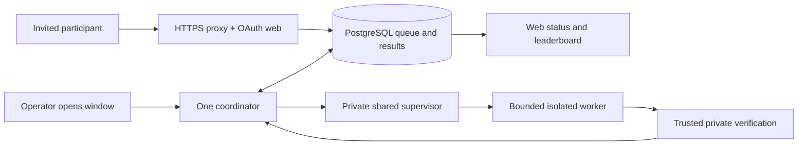

# Proposed smaller 0.5.0 research preview

Review date: 2026-10-26. **Proposal only.** No deletion, installation, evaluation,
epoch, notification or launch is authorized. Existing requirements apply until
explicitly replaced. Scope: existing VPS, $0, tiny synthetic instances, frozen
0.5.0 scoring and verification; 0.6.0, C diagnostics, capacity investigations and
backup setup remain outside scope.

## Recommended operating design (one-page procedure)

Choose an invited, supervised preview. Keep the website and database available;
accept bounded submissions into the existing PostgreSQL queue. Run the coordinator
only during an announced window with a named operator present. Participants use
GitHub login, create a token, submit an immutable eligible Python source commit
with an idempotency key, inspect status and see verified cohort results. Waiting
outside windows is expected and must be stated on the submission page.

The operator prepares one audited private epoch/reference/cohort under separate
authority before participant work. Keep one immutable application/runtime release,
its private configurations and one verified compatible rollback. Deploy from an
exact reviewed command sheet: pause admissions and computation, require zero
pending work, stop identified scheduling owners, install pinned artifacts, inspect
actual identities, test the installed controls, then verify TLS/login and one
separately authorized functional journey. Preserve web/database/proxy where possible;
never run an implicit migration during an application switch.

At each window, check HTTPS, database readiness, queue bounds, retained services,
resource floors, supervisor identity and absence of unresolved ownership. Explicitly
resume the supervisor and start the sole coordinator. The supervisor retains
host-wide exclusion with administrative work, containment, bounded disk/output,
termination verification and commit reconciliation. An operator cannot substitute
for these protections. At window close, stop new dispatch through a reviewed pause
procedure, let the current job finish or use verified cancellation, inspect that
owned resources are gone, and leave computation persistently paused across reboot.
Queued jobs stay queued. Admission closure is separate from dispatch pause.

On a crash or restart, remain paused. Inspect the durable ownership journal and
matching database attempt; verify termination and reconcile any result commit
before releasing ownership. Never clear a lease, delete a journal or rerun an
ambiguous computation. For a failed deployment, keep computation inhibited, restore
the pinned compatible application/runtime/configuration using the command sheet,
check retained services and identities, then explicitly reopen a window. If schema
compatibility or termination is uncertain, stay offline for evaluation. Rollback is
not recovery from database loss. Assign manual HTTPS checks at window open/close
and every 15 minutes while open, plus daily while closed, with a named incident
contact. This trades unattended detection for documented operator responsibility.

## What exists and what launch requires

The minimum launch is authenticated access, bounded admission/execution, a correct
private audited evaluation, trustworthy transactional publication, basic availability
checks and a usable paused recovery procedure. It does not require continuous
execution, automatic repair or a reusable installation framework.

Evidence is repository-local, not a fresh VPS inspection. [Production Compose](../compose.production.yaml)
already separates proxy/web/database/coordinator, pins images through required
variables, bounds admission (defaults 1 outstanding/account, 2/day, 10 queued),
removes the coordinator Docker socket and requires a private supervisor.
[Submission services](../src/mldsafail/web/services.py) enforce idempotency and
admission; [queue](../src/mldsafail/evaluator/queue.py) serializes claims and refuses
stale recovery without verified termination. [Coordinator](../src/mldsafail/evaluator/coordinator.py)
and the [runtime runbook](SINGLE_WORKLOAD_DEPLOYMENT.md) describe private dispatch,
verification and commit acknowledgement. These are source facts, not installed
acceptance. [Historical host inspection](acceptance/integration/maintenance-feasibility-20261020.md)
found about 2 GiB physical RAM, a restarting coordinator and old checkout sources
without the reviewed mutex. Do not assume that checkout or Compose describes the
running release. The [latest engineering handoff](acceptance/production-preparation/protected-runtime-engineering-20261026.md)
and [control guide](WORKLOAD_CONTROL_ENGINEERING.md) still require privileged host
facts, installed acceptance and complete proposal review. No evidence establishes
that the frozen workload will complete on this VPS under the retained limits.
Failure to fit means keep evaluation closed, not weaken limits or scoring.

## Three concrete choices

| Design | Participant and operator experience | Protections and remaining blockers | Complexity actually removed |
| --- | --- | --- | --- |
| Current automated design | Continuous bounded queue dispatch; operator maintains generic bootstrap, journals, collectors, scenario runners and recovery tooling. | Retains shared containment and commit safety. Requires host facts, complete installation/restoration proposal, installed native acceptance, policy disposition, audited epoch, TLS/auth and final journey. | None; most general machinery must be finished and accepted. |
| Smaller automated design | Same continuous submissions/results; fixed release installed manually; operator handles recovery on incident. | Same runtime boundary; still needs all actual host/control/benchmark gates and unattended availability responsibility. Fixed-install and recovery checks replace generic installer coverage. | Removes generalized installer/continuation paths from the supported launch workflow, but continuous dispatch still needs unattended operating coverage. |
| **Supervised preview (recommended)** | Small invited cohort queues work; results arrive during published operator windows. Operator opens/closes windows and reconciles incidents using the procedure above. | Same isolation, score, privacy, transactional results and native enforcement. Adds persistent window gate and explicit operating responsibility; actual epoch and final deployment remain blockers. | Also removes unattended scheduling/reopening and automated availability recovery from launch scope. Does not remove cleanup, journals or commit reconciliation. |

Supervision limits exposure and makes the operating commitment credible for a $0
preview; it does not solve insufficient memory or sandbox escape. Smaller automatic
dispatch can follow after real operating experience. If nobody accepts the manual
cadence, this recommendation is not ready to launch.

## Prioritized dispositions and affected areas

Each row states the need, burden, alternative and consequence. “Remove” means a
future reviewed change to the supported launch path, not permission to delete now.

| Priority / component | Need and cost | Proposed disposition, resulting behavior and risk | Specific areas |
| --- | --- | --- | --- |
| P0 authentication, HTTPS, sessions, CSRF, tokens | Prevent unauthorized account actions; OAuth/TLS secrets and renewal require real checks. | **Keep.** Existing GitHub auth and proxy; no alternate login system. Failure closes admission. Verify real callback and renewal/reload. | `src/mldsafail/web/auth.py`, `api.py`, `compose.production.yaml`, `deploy/Caddyfile.production`, `reload_production_tls.py` |
| P0 queue, quotas, idempotency, cancellation | Prevent duplicate evaluation and backlog growth; DB concurrency is real complexity. | **Keep.** One queue, existing bounds; supervision adds no queue. Different keys still consume quota. Cancellation must verify cleanup before new work. | `web/services.py`, `web/models.py`, `evaluator/queue.py`, `repositories.py` |
| P0 private evaluator, source validation, audit, verification and cohort publication | Protect secrets and scientific correctness; frozen dependencies are necessary. | **Keep unchanged.** Invalid answers ineligible; frozen timeout/no-answer penalties remain. No email/file-based scoring substitute. | `benchmark_v050/`, `evaluator/source.py`, `evaluator/coordinator.py`, `web/comparison.py`, `docs/PRIMITIVE_SELECTION_SPEC.md` |
| P0 host lock, supervisor, native adapter and watchdog/independent cleanup | DB lease alone cannot stop surviving containers; memory/output exhaustion threatens retained services. Cost: cgroups, private socket, identity journals and bounded storage. | **Keep.** Watchdog detects failure, cleanup stops creators/workers; neither may automatically reopen scheduling. Manual observation cannot replace kernel enforcement or termination proof. | `evaluator/workload_service.py`, `evaluator/native_workload.py`, `deploy/workload_watchdog.py`, `workload_native_supervision.py`, `SINGLE_WORKLOAD_DEPLOYMENT.md` |
| P0 resource and scheduling prerequisites | Existing owner direction requires one heavy workload, CPU/RAM/PID/disk/output limits and host reserve. Full scheduler inventory is burdensome but unknown restart owners can overlap. | **Keep, scope to the fixed installation.** Classify all actual trigger owners once, inhibit competing heavy work, refresh relevant identities for execution. No blanket exemption for cron, other accounts or existing backup timers. No capacity experiment. | `deploy/workload_schedule_v3.py`, `privileged_scheduling.py`, `workload_owner_readers.py`, `PROTECTED_RUNTIME_OWNER_COLLECTION.md` |
| P0 workload journal, DB/operator commit barrier and reconciliation | Interrupted insertion can lose or duplicate results; costs identity binding and explicit recovery. | **Keep.** Publication remains transactional, acknowledged work is not recomputed. Ambiguity blocks launch. This is distinct from generalized installation recovery. | `evaluator/` protected dispatch, `deploy/protected_epoch.py`, `workload_native_protocol.py`, runtime runbook |
| P1 always-on coordinator and retry/reopen policy | Unattended throughput is optional for invitees; restart policies can launch work when nobody is watching. | **Simplify** to persistent closed-by-default window control, explicit resume, bounded FIFO dispatch. Remove unattended reopening; review ordinary infrastructure retries so none escape the window or repeat ambiguous outcomes. Loss: delayed results and operator dependence. Not implemented today. | `compose.production.yaml` coordinator restart policy, `evaluator/coordinator.py`, `deploy/workload_units.py`, `ADMINISTRATIVE_CONTROLS.md` |
| P1 deployment/install recovery framework | Safe installation and rollback are needed; generic external-effect continuation, VM fixtures and protocol matrices multiply dependencies. | **Simplify** to one host-bound command sheet with before/after evidence and manual stop-on-ambiguity. **Defer** generic restartable installer. Interrupted steps require inspection before fresh authority, not blind replay. Retain known-good artifacts and verify rollback; manual steps are explicit work, not eliminated work. | `deploy/workload_installation.py`, `workload_mutation.py`, `workload_recovery_inventory.py`, `workload_v3.py`, `scripts/workload_installation_fixture.py`, `PROTECTED_RUNTIME_IMPLEMENTATION_PLAN.md`, `WORKLOAD_INSTALLATION_FIXTURE.md` |
| P1 overlapping acceptance and approval packets | Exact authority and independent review protect live services; repeated nested prerequisites obscure readiness. | **Simplify** to one release-bound installation/control acceptance matrix, one exact installation proposal and separate epoch/activation authorities. Reuse matching receipts; do not infer passes. Keep distinct authority scopes. Loss: less generic automation coverage, compensated by fixed-install interruption checks. | `deploy/workload_acceptance_packet.py`, `workload_packet_preparation.py`, `scripts/prepare_workload_packet.py`, `PUBLIC_LAUNCH_PACKET.md`, `LAUNCH_PREPARATION.md` |
| P1 protocol generations and validators | Historical receipts must remain interpretable; supporting every generation for new launches invites confusion. | **Remove** v1–v3 selection from the new launch path; select current v4 administrative authority only. Preserve old validators/records read-only until dependency audit proves archival separation. Loss: no new launch from old packets. No historical validation rules weakened. | `deploy/production_maintenance.py`, `production_epoch_operation.py` in `scripts/`, `deploy/workload_native_packet.py`, `workload_v3.py`, `SINGLE_WORKLOAD_DEPLOYMENT.md` |
| P1 availability, alerts and automatic recovery | Need to notice outages; lease alarms and auto recovery add failure paths. | **Simplify** to named manual checks/cadence above; **defer** remote lease alerts and automatic repair/activation. Keep local watchdog/cleanup. Loss: outages between checks and outside windows can last longer; HTTPS does not certify worker health. No notification sent by this review. | `deploy/healthchecks.py`, `host_checks.py`, `recovery_daemon.py`, `daily_recovery.py`, `operator_activation.py`, `scripts/monitoring_fault_acceptance.py`, MVP item 7 |
| P2 diagnostic/capacity/0.6.0 and backup workstreams | Historical tools explain outcomes but are not launch functionality. Additional campaigns create cost and scope creep. | **Defer**, remove as launch prerequisites only where already owner-settled. Preserve failures and scientific evidence. Backup absence means irreversible data-loss risk; existing timers cannot be disabled under this proposal without their own disposition. | `scripts/production_diagnostic*`, `capacity_investigation*`, `benchmark_v060/`, `deploy/backup_postgres.py`, `install_restic.py`, dated acceptance packets |
| P2 release caches, duplicate contexts and trial stores | Needed only while active or for unresolved evidence; disk burden matters on VPS. | **Remove eligible bulk later** under retention ownership/inactivity checks; keep compact records, current installation, verified rollback and scientific evidence. Risk: mistaken classification destroys recovery; no broad prune or shared-hardlink edits. | `RETENTION_POLICY.md`, `BUILD_CACHE_RETIREMENT.md`, `scripts/retire_build_cache.py`, `retain_release.py` |

## Changes that must travel together

Window control, coordinator restart policy, retries, queue status text and operator
pause/reboot tests form one change: stopping a container alone is not persistent
inhibition. Fixed installation must replace the generic installer entrypoint,
its required acceptance matrix, launch documentation and restoration commands
together; simply skipping its failing gate is not simplification. Protocol routing,
packet validators and CLI/documented defaults must select the same generation.
Do not remove legacy modules until imports, historical receipt readers and recovery
consumers have been inventoried. Alert deferral must name the human cadence/contact
at the same time. Retention removal must retain the rollback dependency closure.

## Bounded implementation batches (future authorization required)

| Order | Deliverable and acceptance | Reversal |
| --- | --- | --- |
| 1. Freeze the contract | Owner selects supervised windows, manual monitoring and fixed-install policy; independent review maps each old gate to retained, replaced or historical. Explicitly resolve the measured-capacity gate through reviewed v4 unmeasured-capacity policy without measurements or fabricated receipts. Approve no runtime safety waiver. Exit: one finite acceptance matrix, no unresolved safety disposition. | Keep current policy and remain paused; this document alone replaces no gate. |
| 2. Add window behavior | Implement persistent closed-by-default dispatch, explicit resume, participant waiting text and reviewed retry behavior. Check duplicate submission, cancellation, competing coordinator/admin launch, window close and reboot; no work starts while closed. | Revert application/config commit while paused; do not resume an earlier automatic policy without authority. |
| 3. Prepare one fixed install and restore | Inventory actual host triggers/UIDs/cgroups/storage, pinned dependencies and compatible rollback. Write exact install/stop/inspect/restore commands and release-bound checks; locally rehearse interruptions before/after mutation, including image load and service switch. Review independently. No growing generic continuation framework. Exit: complete reversible packet, kernel/output bounds demonstrable, original settings captured. | Retain existing installation untouched until separate execution approval; restore named artifacts/settings on a failed authorized switch. |
| 4. Accept actual runtime | Under separate installation/native-test authority, apply packet paused and verify isolation, limits, peer rejection, parent/worker death, cleanup, startup inhibition and retained-service availability. Ambiguous commit/restart cases must block then reconcile. If frozen workload cannot fit, stop with no score/rule adjustment. | Execute verified restore sheet; leave compute paused if identity/termination is uncertain. |
| 5. Establish benchmark and functional launch | Separately authorize one fresh epoch, audit/seal/reference/cohort; finalize configuration. Verify actual TLS/OAuth/token lifecycle and final participant journey, monitoring procedure and rollback compatibility. Owner reviews exact rollout packet before invitation/publication. | Keep admission/compute closed; retain failed evidence and original epoch outcomes. No automatic epoch retry. |
| 6. Retire unused launch paths | After accepted replacement, remove obsolete launch entrypoints/docs and only dependency-audited dead code in separate commits; preserve historical readers and records. Link/import checks and affected tests must pass. Retention cleanup is separately scoped. | Revert removal commit; restore only matching inactive artifacts, never revive old scheduling owners automatically. |

## Failure walkthrough and required evidence

These are design checks, not claims that new behavior has passed runtime tests.

| Event | Expected outcome / acceptance observation |
| --- | --- |
| Normal submission | Authenticated immutable source enters bounded queue, waits for window, sole supervised worker evaluates public inputs, trusted verifier checks private evidence, matching cohort result commits once and becomes visible. |
| Duplicate submission | Same account/key/body returns existing submission; changed body conflicts. Concurrent requests cannot create two jobs for that key; other keys obey quotas. |
| Timeout | Frozen per-instance timeout/cap/no-answer receives frozen 60-second penalty; invalid answer remains ineligible. Supervisor protection failure is infrastructure failure without a score, stays paused and preserves evidence. |
| Worker/coordinator crash | Ownership remains held until positive container/process termination and attempt reconciliation. No replacement through lease expiry. Any ordinary retry needs a still-open window and proven safe eligibility. |
| Server restart | Web/database may restart; computation stays inhibited. Reconcile journal births, Docker/cgroups, pending DB attempts and commit acknowledgement before explicit operator resume. |
| Interrupted result recording | Durable intent plus DB reconciliation preserves a matching committed result once; uncommitted orphan becomes infrastructure failure after cleanup. Never recompute merely because acknowledgement was lost. |
| Failed deployment | Stop at uncertain mutation, preserve observations, keep compute inhibited and restore exact compatible files/images/configuration. No automatic migration/downgrade or database restore assumption. Verify retained services before reopening. |

## Replacement launch checklist (proposed)

**Engineering:** implement batch 2; finish fixed-install packet and finite acceptance
matrix; verify actual containment, output storage and restart/commit failure cases;
retain a compatible rollback; bind final package, evaluator, configuration and
cohort identities. No source-only pass certifies the VPS.

**Operator:** collect required privileged facts once for the selected installation;
perform separately authorized paused install/native checks; create the separately
authorized audited production benchmark; verify real HTTPS/OAuth/token and one final
participant journey; test restoration; name incident contact and record manual
checks/window schedule. Preserve original failures and compact run records.

**Owner decisions:** accept delayed supervised results and the named manual check
cadence; approve replacing the general installation/acceptance workflow with the
fixed-release packet (this changes existing procedural requirements); explicitly
adopt the reviewed unmeasured-capacity execution-policy disposition (the old
validator requirement is currently unsatisfied); decide whether launch may proceed
with deferred backups and potential permanent loss of database/epoch/evidence.
Then separately approve exact installation, native checks, epoch and final
activation/publication scopes as applicable. Invitations are not authorized here.

No change to tiny-instance restrictions, frozen scoring, private-data isolation,
answer verification, shared host exclusion, reserve/limits or positive termination
is proposed. If a fixed-install path cannot meet these, the launch stays blocked.
